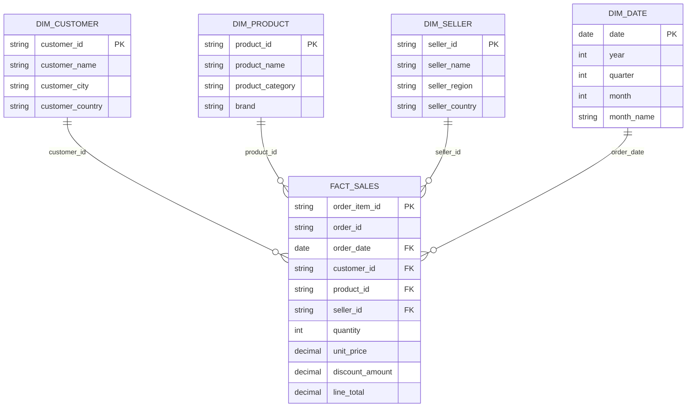

<!-- =========================================================
     NOVACOMMERCE | END-TO-END DATA ANALYTICS PROJECT
     Main repository README
========================================================== -->


<h1 align="center">NovaCommerce</h1>

<p align="center">
  <strong>End-to-End E-Commerce Data Analytics</strong>
  <br />
  <em>From raw data to business decisions.</em>
</p>

---

# 01. Project Overview

**NovaCommerce** is an end-to-end Data Analytics project built around a simulated e-commerce business.

The project explores how data can be transformed into actionable business information through a structured analytical workflow, combining business understanding, data quality assessment, SQL analysis, dimensional modeling, KPI development, and interactive Power BI reporting.

Rather than focusing exclusively on dashboards, NovaCommerce demonstrates the complete process behind an analytical solution:

- Understanding business requirements.
- Preparing and validating source data.
- Transforming data into analytical structures.
- Investigating business performance using SQL.
- Designing a Star Schema.
- Developing business metrics using DAX.
- Communicating findings through interactive dashboards.
- Translating analytical results into business recommendations.

The central objective is to demonstrate how a Data Analyst can connect technical execution with business understanding.

> **Project Context**
>
> NovaCommerce is a fictional e-commerce business created for analytical and portfolio purposes. All data and business results are simulated. They demonstrate analytical methods and should not be interpreted as the actual performance of a real organization.

---

# 02. Project at a Glance


| Business Metric | Result |
|:---|---:|
| Total Source Records | 121,100 |
| Total Orders | 20,000 |
| Order Items | 35,237 |
| Units Sold | 44,414 |
| Customers with Orders | 6,046 |
| Recorded Net Order Value | 6,065,773.69 |
| Average Order Value | 303.29 |
| Repeat Purchase Rate | 72.63% |

*Financial figures are expressed in the dataset's numeric currency units. See the metric interpretation section for important context.*

---

# 03. Business Objectives

The analysis was structured around five main business objectives.

| Business Area | Analytical Objective |
|:---|:---|
| Sales Performance | Understand order value, sales trends, order volume, and average order value. |
| Product Performance | Identify the categories and products contributing most to recorded order value. |
| Geographic Performance | Compare customer markets and their contribution to the business. |
| Customer Behavior | Understand purchasing frequency and distinguish repeat customers from one-time customers. |
| Business Intelligence | Translate analytical findings into clear visualizations and business recommendations. |

These objectives guided the analytical questions, SQL investigations, KPI definitions, and final dashboard structure.

---

# 04. Power BI Dashboard

The final report was organized into two pages, providing complementary perspectives on the simulated business.

## 01 — Sales Overview

**Objective:** Provide a consolidated view of sales performance and identify the main contributors to recorded order value.

### Key Performance Indicators

- Net Revenue
- Total Orders
- Average Order Value
- Units Sold

### Visual Analysis

| Visualization | Business Purpose |
|:---|:---|
| Revenue Over Time | Understand changes in recorded order value across the analysis period. |
| Revenue by Category | Identify the product categories contributing most to order value. |
| Revenue by Country | Compare geographical contribution. |
| Top 10 Products | Identify the highest-value products. |

<p align="center">
  
</p>

<p align="center">
  <em>Figure 1 — Sales Overview Dashboard</em>
</p>

---

## 02 — Customer Insights

**Objective:** Understand customer purchasing behavior, customer distribution, and revenue contribution by customer segment.

### Key Performance Indicators

- Customers with Orders
- Repeat Customers
- One-time Customers
- Repeat Purchase Rate
- Average Revenue per Customer

### Visual Analysis

| Visualization | Business Purpose |
|:---|:---|
| Customer Distribution | Understand the proportion of customers in each segment. |
| Revenue by Segment | Compare recorded net order value across customer segments. |

### Customer Segmentation

Customers were classified according to their historical number of orders:

| Segment | Definition |
|:---|:---|
| No Purchase | Customers with no recorded orders. |
| One-time Customer | Customers with exactly one order. |
| Repeat Customer | Customers with more than one order. |

<p align="center">
  
</p>

<p align="center">
  <em>Figure 2 — Customer Insights Dashboard</em>
</p>

---

# 05. Technology Stack

The project combines analytical database technologies, data transformation, business calculations, and visualization tools.

| Technology | Application |
|:---|:---|
| SQL | Data validation, transformation, aggregation, and exploratory analysis. |
| MotherDuck | Cloud analytical database. |
| DuckDB | SQL engine and database connectivity. |
| DuckDB ODBC Driver | Database connectivity on Windows. |
| DuckDB Power Query Connector | Connection between MotherDuck and Power BI. |
| Power Query | Data import and preparation. |
| DAX | KPI calculations and customer segmentation. |
| Power BI Desktop | Data modeling, reporting, and visualization. |

---

# 06. Data Architecture

## Source Dataset

The simulated e-commerce dataset contains eight source tables and 121,100 records.

| Source Table | Records | Description |
|:---|---:|:---|
| `customers` | 8,000 | Customer information and geographical attributes. |
| `products` | 500 | Product information, categories, and costs. |
| `sellers` | 300 | Seller information and geographical attributes. |
| `orders` | 20,000 | Order dates, statuses, customers, and sales channels. |
| `order_items` | 35,237 | Products, quantities, unit prices, and discounts per order. |
| `payments` | 22,063 | Payment transactions, statuses, and methods. |
| `reviews` | 15,000 | Customer review records. |
| `shipping` | 20,000 | Shipping and delivery records. |
| **Total** | **121,100** | **Source records** |

## Star Schema

After data preparation and analytical validation, a dimensional model was designed in MotherDuck and imported into Power BI.

The final model contains one fact table and four dimension tables.

<p align="center">
  
</p>

<p align="center">
  <em>Figure 3 — Power BI Data Model</em>
</p>

### Data Model Structure



### Fact Table

**`fact_sales`**

- Grain: one row per order item.
- Total records: 35,237.
- Contains order, customer, product, seller, date, quantity, price, discount, and line-total information.

### Dimension Tables

| Dimension | Records | Analytical Purpose |
|:---|---:|:---|
| `dim_customer` | 8,000 | Customer segmentation and geographical analysis. |
| `dim_product` | 500 | Product and category analysis. |
| `dim_seller` | 300 | Seller and regional analysis. |
| `dim_date` | 1,096 | Calendar-based analysis from 2023 to 2025. |

The model uses one-to-many relationships from dimension tables to `fact_sales`, with single-direction filtering.

The Date dimension was marked as the official Date Table in Power BI.

### Modeling Decisions

The original `payments`, `shipping`, and `reviews` tables have different levels of granularity from the order-item fact table.

They were not directly joined to `fact_sales`, avoiding potential row multiplication and incorrect aggregations.

This was an important modeling decision to preserve the reliability of sales calculations.

The final Power BI report focuses on the Sales Overview and Customer Insights pages.

---

# 07. Analytical Workflow

The project was organized into ten structured steps.

| Step | Stage | Deliverable |
|:---|:---|:---|
| 01 | Business Understanding | Business objectives and analytical questions. |
| 02 | Dataset Generation & Data Architecture | Synthetic dataset and source-table structure. |
| 03 | Database Setup & Data Import | MotherDuck database and imported source tables. |
| 04 | Data Import Validation | Import and record-count validation. |
| 05 | Data Quality Assessment | Data quality investigation and validation. |
| 06 | Data Transformation & Analytical Preparation | SQL transformations and analytical views. |
| 07 | Exploratory Data Analysis | Initial business metrics and analytical findings. |
| 08 | Dimensional Modeling & Power BI Connection | Star Schema and Power BI connection. |
| 09 | Power BI Dashboard Development | Interactive Sales Overview and Customer Insights dashboards. |
| 10 | Business Insights & Project Conclusion | Business interpretation, recommendations, and final documentation. |

## Data Quality Approach

Data quality checks covered:

- Primary-key uniqueness.
- Missing values.
- Referential integrity.
- Logical value ranges.
- Quantity, pricing, and discount consistency.
- Payment-value investigation.

The validation process identified no duplicate primary keys across the eight source tables and no orphaned foreign-key references in the checks performed.

Four negative payment amounts were identified and investigated. Their root cause was not established, so they were not automatically classified as errors or modified.

Missing shipping and delivery dates were also evaluated in the context of order status rather than indiscriminately treated as invalid records.

No source records were updated or deleted during the quality assessment.

---

# 08. Key Performance Indicators

The following KPIs were developed to support the final analytical report.

| KPI | Calculation / Definition | Result |
|:---|:---|---:|
| Gross Revenue | Quantity × Unit Price, summed across order items. | 6,342,691.36 |
| Total Discounts | Sum of item-level discount amounts. | 276,917.67 |
| Net Revenue | Sum of item-level `line_total`. | 6,065,773.69 |
| Total Orders | Distinct count of orders. | 20,000 |
| Average Order Value | Net Revenue ÷ Total Orders. | 303.29 |
| Units Sold | Sum of item quantities. | 44,414 |
| Customers with Orders | Distinct customers with at least one order. | 6,046 |
| Repeat Customers | Customers with more than one order. | 4,391 |
| One-time Customers | Customers with exactly one order. | 1,655 |
| Repeat Purchase Rate | Repeat Customers ÷ Customers with Orders. | 72.63% |

### Metric Interpretation

**Net Revenue / Recorded Net Order Value**

The calculation represents the sum of item-level `line_total` across the dataset.

It includes orders in all statuses, including cancelled, processing, shipped, and delivered orders.

Therefore, it must not be interpreted as recognized accounting revenue, confirmed realized revenue, or cash received.

**Average Order Value (AOV)**

Calculated by dividing the recorded net order value by the number of distinct orders.

It inherits the same order-status limitation.

**Repeat Purchase Rate**

Calculated using the number of repeat customers divided by the number of customers with at least one order.

Customer classification is based on the complete 2023–2025 history, not dynamically recalculated for a selected date range.

**Currency**

Financial values are presented in the dataset's numeric currency units. No single currency symbol is applied in this README because the dataset contains a currency field and the reporting figures are presented as aggregated numeric values.

---

# 09. Key Business Insights

The analysis identified several patterns that could support further business investigation.

## 01 — Customer Retention

**72.63% of purchasing customers placed more than one order.**

| Customer Metric | Result |
|:---|---:|
| Customers with Orders | 6,046 |
| Repeat Customers | 4,391 |
| One-time Customers | 1,655 |
| Repeat Purchase Rate | 72.63% |

**Interpretation**

Repeat purchasing represents a substantial part of customer activity within the analyzed period.

**Business Opportunity**

Investigate customer retention strategies, loyalty initiatives, and personalized campaigns to encourage additional purchases.

## 02 — Electronics Leads Category Contribution

**Electronics generated approximately 43.85% of total recorded net order value.**

| Metric | Result |
|:---|---:|
| Electronics Net Order Value | 2,660,202.04 |
| Total Net Order Value | 6,065,773.69 |
| Category Contribution | 43.85% |

**Interpretation**

Electronics is the leading category in terms of recorded net order value.

**Business Opportunity**

Investigate product-level profitability, demand, and complementary purchases to understand the category's contribution in greater detail.

## 03 — Geographic Concentration

**The United States represents approximately 57.5% of recorded net order value.**

| Country | Net Order Value |
|:---|---:|
| United States | 3,487,275.70 |
| United Kingdom | 953,798.74 |
| Canada | 984,319.66 |
| Australia | 640,379.59 |

**Interpretation**

The United States is the largest geographical market in the dataset.

**Business Opportunity**

Investigate opportunities to diversify geographical revenue while maintaining performance in the largest existing market.

## 04 — Website and Mobile App Lead Sales Channels

| Sales Channel | Net Order Value |
|:---|---:|
| Website | 2,550,781.66 |
| Mobile App | 2,313,588.92 |
| Marketplace | 1,201,403.11 |

**Interpretation**

The Website and Mobile App account for the majority of recorded net order value.

**Business Opportunity**

Compare conversion rates, customer acquisition costs, and contribution margins across sales channels before making investment decisions.

## 05 — Annual Order Value Remained Relatively Stable

| Year | Net Order Value |
|:---|---:|
| 2023 | 2,003,129.42 |
| 2024 | 2,048,500.59 |
| 2025 | 2,014,143.68 |

**Interpretation**

Annual recorded net order value remained relatively stable across the three-year period.

The figures do not demonstrate a sustained upward growth trajectory.

**Business Opportunity**

Investigate changes in customer volume, purchase frequency, product mix, and average order value to identify potential growth drivers.

---

# 10. Strategic Recommendations

Based on the findings, the following recommendations represent potential business actions.

These are analytical proposals and have not been implemented or experimentally validated.

| Business Area | Recommendation | Suggested Measurement |
|:---|:---|:---|
| Customer Retention | Explore loyalty initiatives and targeted repeat-purchase campaigns. | Repeat Purchase Rate, retention, purchase frequency. |
| Product Strategy | Investigate Electronics performance and complementary product opportunities. | Category contribution, product margins, units sold. |
| Geographic Strategy | Evaluate opportunities to diversify beyond the United States. | Country-level growth, acquisition costs, fulfillment costs. |
| Sales Channels | Compare channel efficiency before reallocating investment. | Conversion rate, CAC, AOV, contribution margin. |
| Revenue Growth | Investigate customer volume, purchase frequency, and basket-size drivers. | Active customers, orders per customer, AOV. |

## Further Analytical Opportunities

The current dataset provides a foundation for additional analyses.

Future work could include:

- Customer Lifetime Value (CLV).
- Customer Acquisition Cost (CAC).
- Cohort retention analysis.
- Purchase frequency trends.
- Product-level profitability.
- Sales channel conversion analysis.
- Delivery performance and customer satisfaction.

These metrics would require additional data or assumptions before reliable calculations could be made.

---

# 11. Project Limitations

A reliable analytical project must clearly identify the limitations of its findings.

| Limitation | Explanation |
|:---|:---|
| Synthetic Dataset | The data represents a simulated business scenario rather than a real organization. |
| Order Status | Recorded net order value includes cancelled and processing orders. |
| Customer Segmentation | Segments are based on full-period historical purchasing behavior. |
| Additional Business Metrics | CAC, CLV, conversion rate, and contribution margin require additional data. |
| Business Recommendations | Suggested actions have not been implemented or tested. |
| Financial Interpretation | Recorded net order value should not be interpreted as cash received or recognized revenue. |

These limitations were considered when interpreting results and developing recommendations.

---

# 12. Repository Structure

The following structure illustrates the intended organization of the project documentation and deliverables.

```text
NovaCommerce/
│
├── README.md
│
├── assets/
│   ├── novacommerce-logo.png
│   └── screenshots/
│       ├── 01-sales-overview.png
│       ├── 02-customer-insights.png
│       ├── 03-star-schema.png
│       └── 04-data-quality-validation.png
│
├── documentation/
│   ├── STEP-01-business-understanding.md
│   ├── STEP-02-dataset-generation.md
│   ├── STEP-03-database-setup.md
│   ├── STEP-04-data-import-validation.md
│   ├── STEP-05-data-quality-assessment.md
│   ├── STEP-06-data-transformation.md
│   ├── STEP-07-exploratory-data-analysis.md
│   ├── STEP-08-dimensional-modeling.md
│   ├── STEP-09-dashboard-development.md
│   └── STEP-10-business-insights.md
│
├── sql/
│   └── [SQL scripts, if included]
│
└── power-bi/
    └── [Power BI report file, if included]
```

*The structure above is illustrative. Folder and file names should match the actual repository contents.*

---

# 13. Reproducibility & Security

The Power BI report connects to MotherDuck through the DuckDB Power Query custom connector.

Reproducing the connection requires:

1. Access to the relevant MotherDuck database.
2. A valid MotherDuck authentication token.
3. The compatible DuckDB ODBC driver.
4. The DuckDB Power Query custom connector.
5. Power BI Desktop.

**Security Consideration**

Database tokens, passwords, personal credentials, and other sensitive information must never be committed to a public repository.

Use local credentials when reproducing the connection.

---

# 14. Final Conclusion

NovaCommerce brings together the core stages of a practical Data Analytics workflow.

From defining business questions and assessing data quality to writing SQL transformations, designing a Star Schema, developing DAX measures, and building interactive Power BI dashboards, each stage contributes to a complete analytical solution.

The project demonstrates practical experience in:

- SQL and analytical querying.
- Data quality assessment.
- Data transformation and preparation.
- Dimensional modeling and Star Schema design.
- Power Query and DAX.
- KPI development.
- Power BI dashboard design.
- Business interpretation and analytical recommendations.

More importantly, it demonstrates an understanding that data analysis is not simply about producing numbers or visualizations.

**It is about asking meaningful questions, building reliable analytical foundations, interpreting evidence, recognizing limitations, and helping businesses make better-informed decisions.**

---


<h3 align="center">NOVACOMMERCE</h3>

<p align="center">
  <strong>From Raw Data to Business Decisions.</strong>
  <br />
  <em>End-to-End Data Analytics Project</em>
  <br /><br />
  November 2026
</p>

<p align="center">
  <sub>Project completed · Portfolio documentation</sub>
</p>
